# Use the balance app

Open a database, select a person, and charge or deposit an amount. Changes save to the SQLite file automatically. Use **Lataa varmuuskopio** when you want a separate copy.

The screenshots show the current Finnish interface. The numbered circles and outlines in each screenshot identify the controls described below. Screenshots use sample accounts with a deep teal primary color and a warm ivory background (`#F7F4EC`). Amounts display two decimal places without currency symbols. Enter `8.50` to subtract 850 of the smallest credit units. You can also enter `8,50`.

## 1. Open or create a database

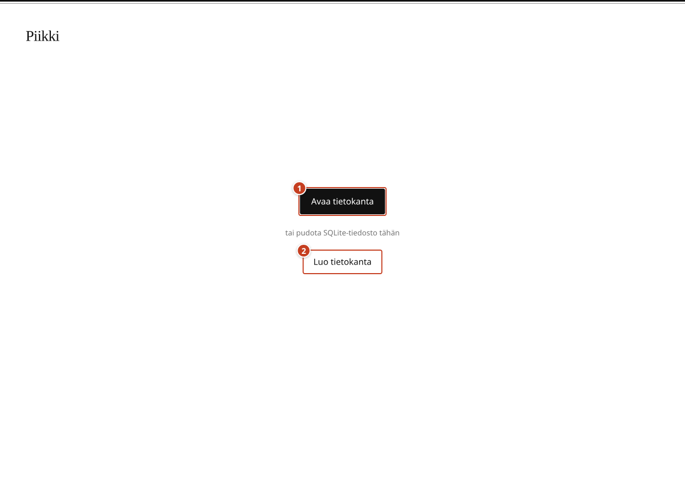

1. Select **Avaa tietokanta** at callout **1** and choose an existing compatible SQLite file. Allow read and write access when the browser asks.
2. To start with no people, select **Luo tietokanta** at **2**. Complete the organization setup below, then choose a save location and filename.

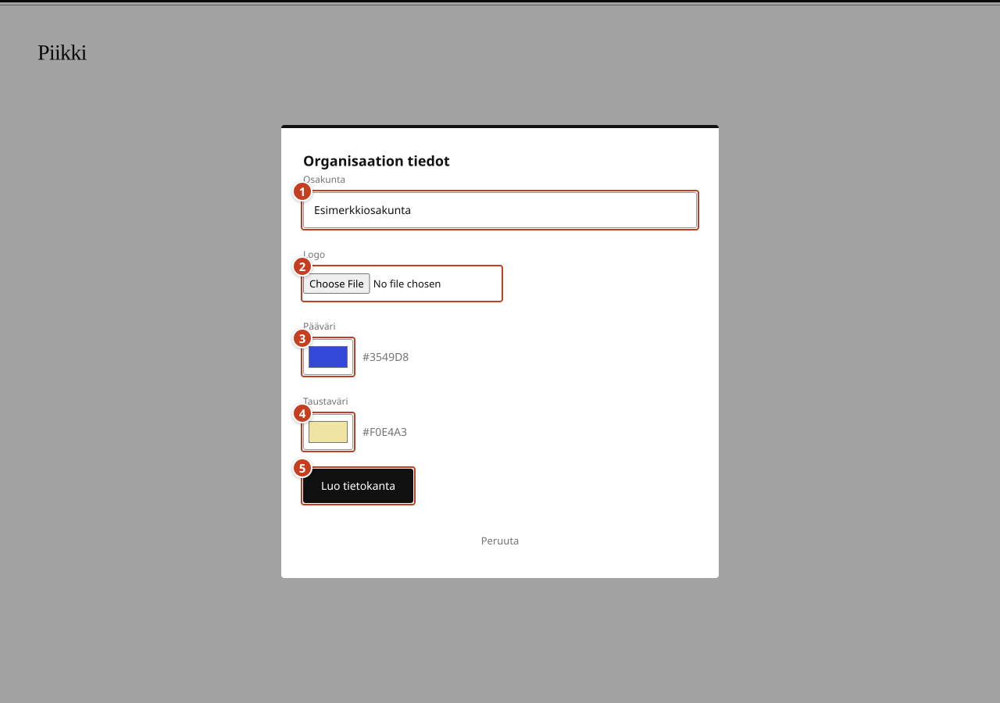

1. Enter the organization name in **Osakunta** at **1**.
2. Choose a **Logo** at **2**, if needed. Use PNG, JPG, WebP, or SVG, up to 1 MB.
3. Choose **Pääväri** at **3** for actions and selected rows.
4. Choose **Taustaväri** at **4** for page and dialog backgrounds. Text and indicator colors adjust automatically for contrast.
5. Select **Luo tietokanta** at **5**, then choose the SQLite file location. Select **Peruuta** to leave without creating a database.

The account workspace opens after the app checks the database and verifies file writing. The browser's file and permission dialogs are not pictured because they vary by device.

You can also drop a compatible SQLite file onto the page. The app then asks for a writable destination before opening the imported copy. Keep track of the destination you choose, since that is the file subsequent changes update. An unrelated SQLite file will not work just because its extension is `.sqlite` or `.db`.

## 2. Find your way around the workspace

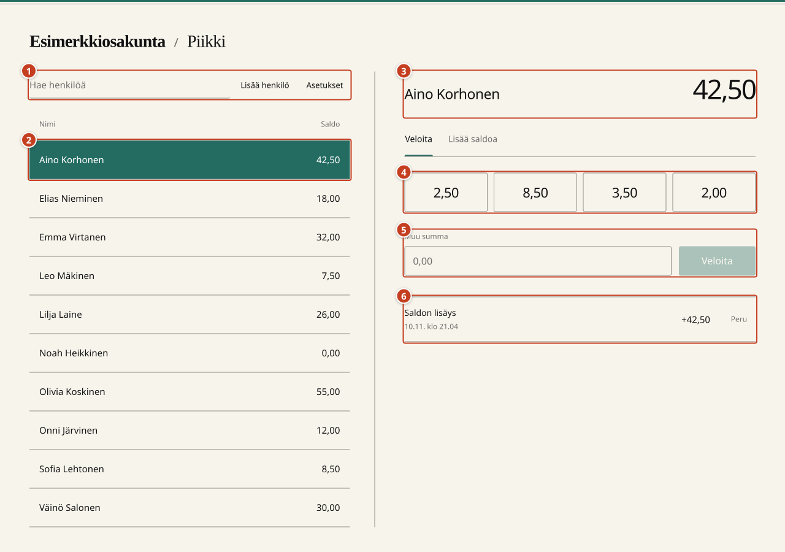

1. Use the search field, **Lisää henkilö**, and **Asetukset** in area **1**.
2. Select a person in the table at **2**. The highlighted row identifies the selected account.
3. Check the person's name and current balance at **3** before entering a transaction.
4. Select an amount at **4** to charge it immediately.
5. Enter another amount at **5**, then select the labeled charge or deposit button.
6. Review transactions at **6**. Newest entries appear first, with an **Peru** button beside entries that can be reversed.

The table and account panel show the same saved balance. The app does not display person IDs, item names, or the active filename. Select **Nimi** or **Saldo** in the table's column labels to change its sort order.

## 3. Search for and select a person

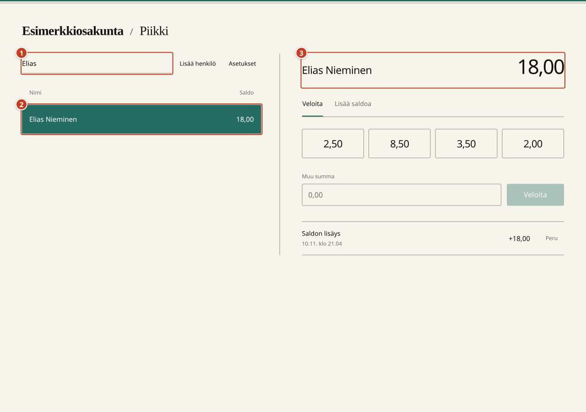

1. Enter part of the person's name in the search field at **1**.
2. Select the matching name at **2**.
3. Check the name and balance at **3**. In this example, Elias has `18.00`.

Typing in search filters the table. It does not select a different person by itself. Clear the search field to show everyone again. If no names match, check the spelling or enter a shorter part of the name.

The remaining transaction examples use Aino, whose starting balance is `42.50`.

## 4. Add a person

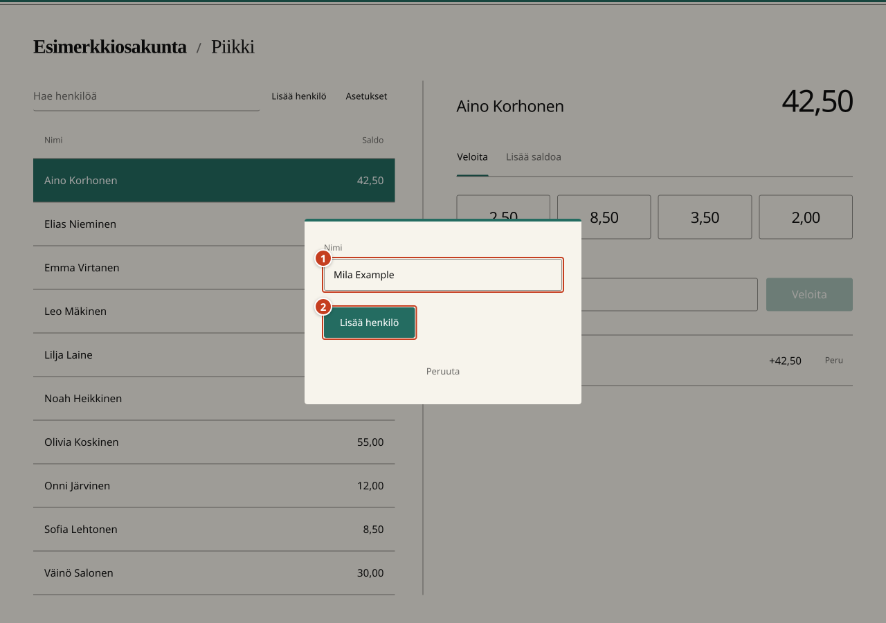

1. Select **Lisää henkilö** beside the search field.
2. Enter the person's name at **1**. Use a name you can distinguish from other accounts.
3. Select **Lisää henkilö** at **2** to save it. Select **Peruuta** to leave without adding anyone.
4. Find and select the new person in the table.

A new person's balance starts at `0.00`. Use a deposit to add their initial credit. Adding a person does not change the currently selected account. Names cannot currently be edited or removed through the UI.

## 5. Apply a quick charge

A quick-charge button subtracts its amount immediately. There is no charge confirmation dialog.

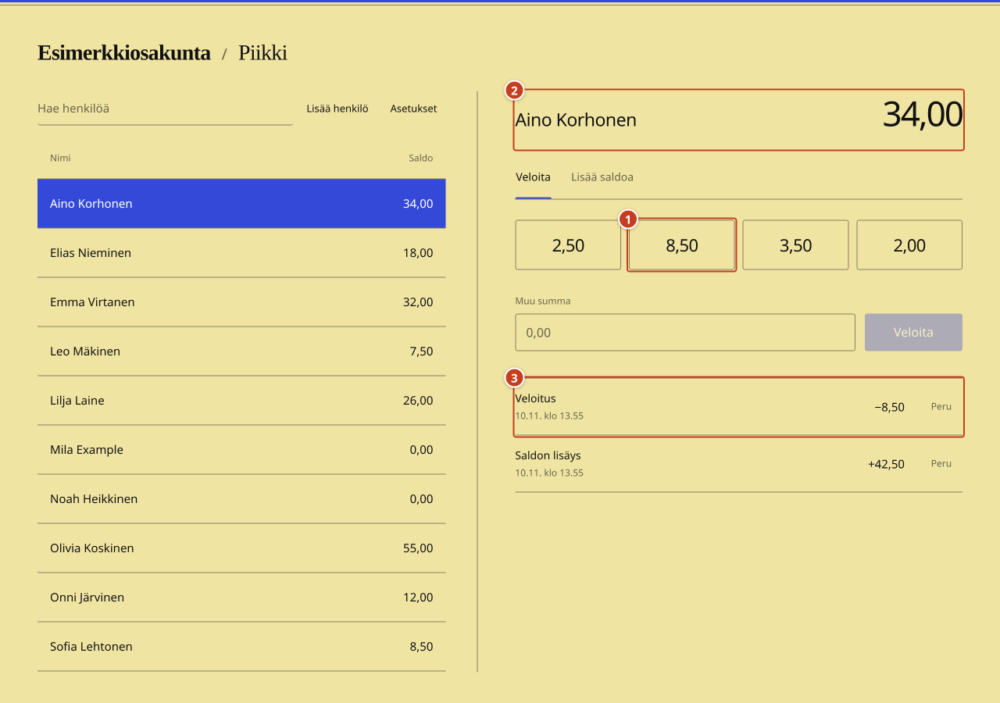

1. Select the person and check their name.
2. In **Veloita** mode, select the `8.50` quick-charge button at **1** once.
3. Check the updated balance at **2** and the new history entry at **3**.

In this example, `42.50` becomes `34.00`. The history records a charge of `−8.50`. Buttons are disabled while the change saves. Quick charges remain available when the balance is zero or negative.

If you select the wrong amount, use **Peru** on that transaction. See section 8.

## 6. Charge a custom amount

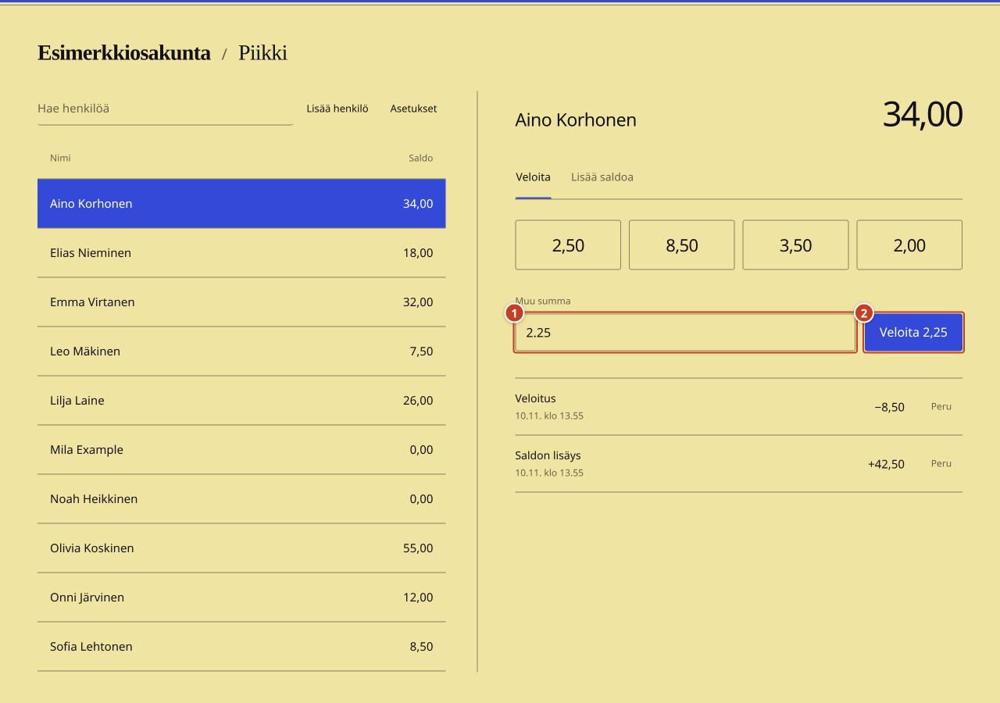

1. Select **Veloita** mode.
2. Enter `2.25` in **Muu summa** at **1**.
3. Check the button text, then select **Veloita 2,25** at **2**. Pressing Enter in the amount field also submits the charge.

The amount clears after the change saves. In this example, the balance changes from `34.00` to `31.75`, and a `−2.25` entry appears in the history.

Use a positive amount with no more than two decimal places. Zero, negative values, and values such as `2.255` are rejected.

## 7. Record a deposit

Record a deposit when someone adds to their balance. The app only records balances; it does not move any money.

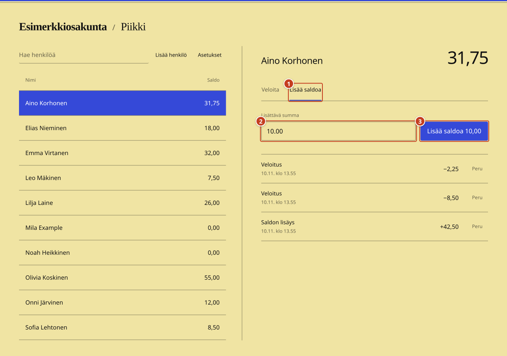

1. Check the person's name and select **Lisää saldoa** at **1**.
2. Enter `10.00` in **Lisättävä summa** at **2**.
3. Select **Lisää saldoa 10,00** at **3** once.

The change applies without another confirmation. In this example, `31.75` becomes `41.75`, and the history gains a `+10.00` deposit. Switch back to **Veloita** when you want to subtract credit.

## 8. Undo a transaction

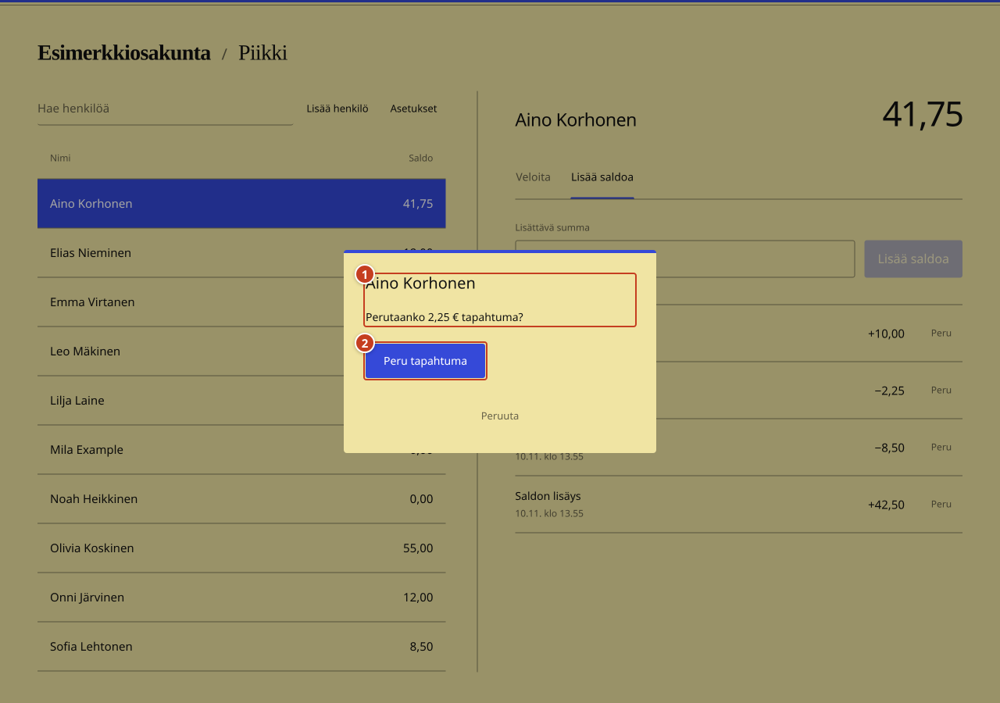

1. Find the transaction in the selected person's history.
2. Select **Peru** beside that entry.
3. Check the person and amount in area **1**. This example reverses the custom charge of `2.25`.
4. Select **Peru tapahtuma** at **2** to apply the reversal. Select **Peruuta** to leave the transaction unchanged.

Undo has its own confirmation because it changes an existing transaction. Reversing a charge adds the amount back. Reversing a deposit subtracts it. A deposit can be reversed even when this makes the balance negative.

## 9. Check a reversal in the history

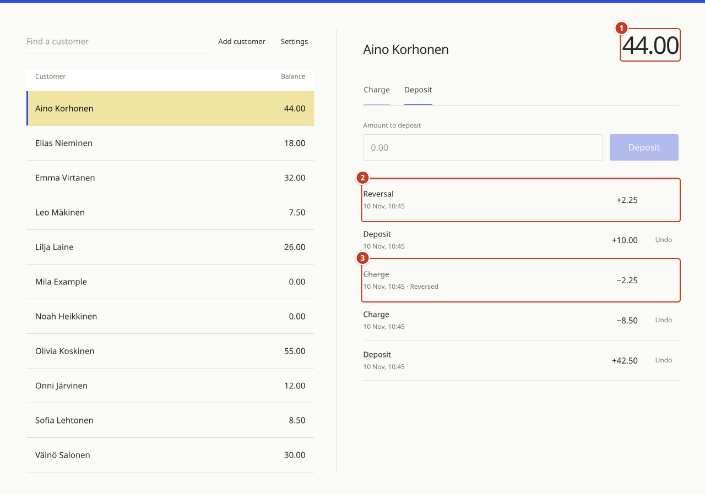

1. Check the new balance at **1**. Reversing the `2.25` charge changes `41.75` to `44.00`.
2. Find the new **Hyvitys** entry at **2**, showing `+2.25`.
3. Find the original charge at **3**. It remains visible and is marked **Peruttu**.

A transaction can be reversed once. The reversal itself has no **Peru** button. History is preserved rather than deleted.

## 10. Change the two colors

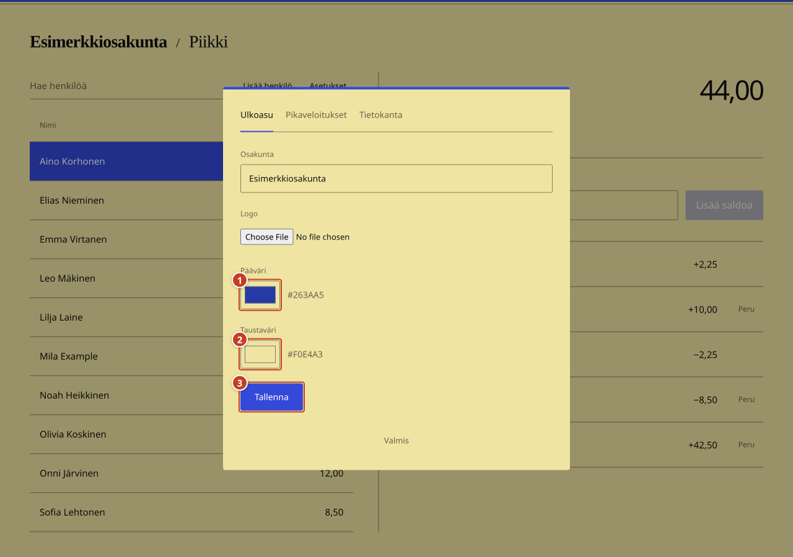

1. Select **Asetukset** beside the search field.
2. Open **Ulkoasu**.
3. Choose the **Pääväri** at **1** for action buttons and interface accents.
4. Choose the **Taustaväri** at **2** for page and dialog backgrounds.
5. Select **Tallenna** at **3** to apply and save the changes.

The button is disabled until the organization name, logo, or a color changes. This screenshot shows a new primary value of `#185C53` before it is saved. The organization name, logo, and colors are stored in the SQLite database and return when that file is reopened. Text colors adjust to meet a 4.5:1 contrast ratio; control borders and focus indicators meet at least 3:1.

Select **Valmis** to close Settings. The browser compatibility screen displays the Piikki wordmark with the default colors.

## 11. Add or edit quick-charge amounts

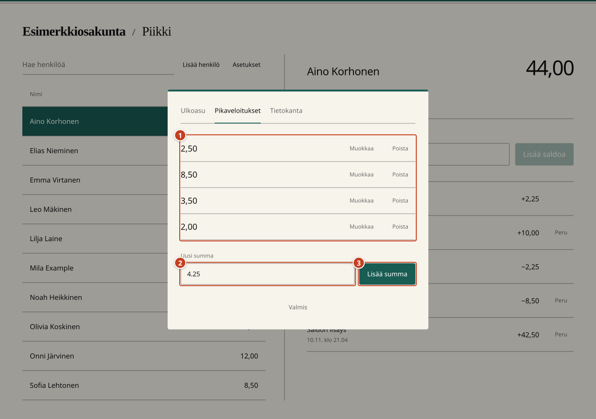

1. Open **Asetukset**, then select **Pikaveloitukset**.
2. Review the saved amounts in the list at **1**.
3. Enter `4.25` in **Uusi summa** at **2**.
4. Select **Lisää summa** at **3**.

To change an existing amount, select **Muokkaa** beside it. Enter the replacement amount and select **Tallenna summa**. Select **Peruuta muokkaus** to leave it unchanged.

Select **Valmis** and return to **Veloita** mode to use the saved shortcuts. Quick-charge settings change future buttons only. They do not alter past transactions or anyone's balance.

## 12. Remove and restore a quick-charge amount

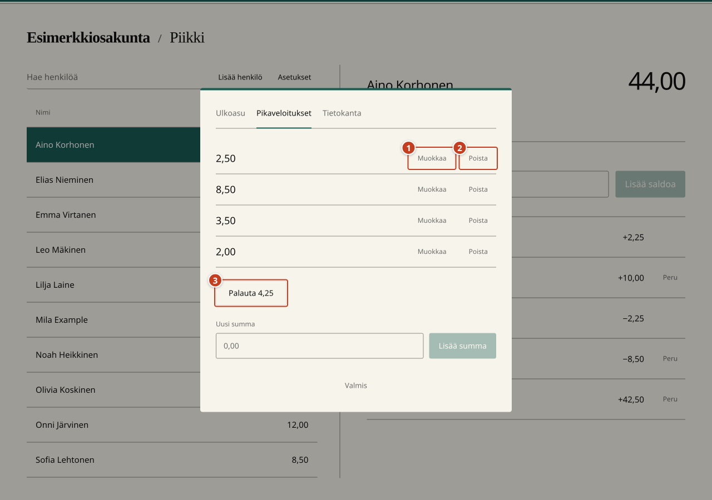

1. Use **Muokkaa** at **1** to change an amount rather than remove it.
2. Select **Poista** at **2** to delete a shortcut from the list.
3. If you removed it by mistake, select **Palauta 4,25** at **3** before closing Settings.

The restore button holds only the most recently removed amount during that Settings session. Removing another amount replaces it. Closing Settings clears that restore option; you can still add the amount again later.

## 13. Save, back up, and reopen your work

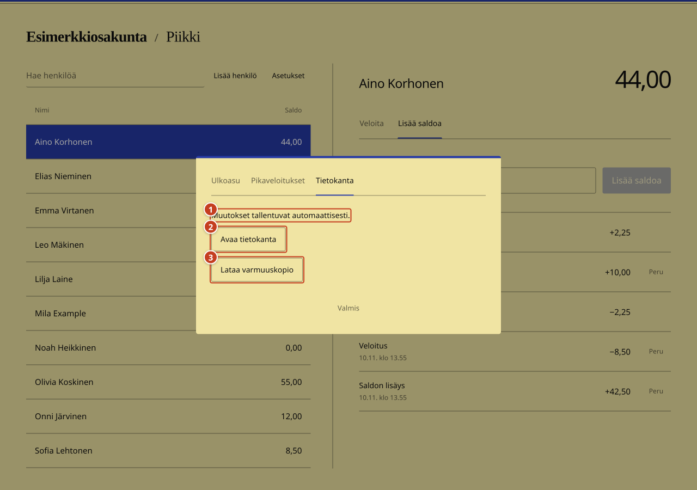

1. Open **Asetukset**, then select **Tietokanta**.
2. Read the save behavior at **1**. Charges, deposits, reversals, settings, and new people save to the opened file automatically.
3. Select **Lataa varmuuskopio** at **3** when you want an additional SQLite copy. Wait for the browser to finish the download.
4. To switch files, select **Avaa tietokanta** at **2**, choose the file, and grant write access.

You do not need a download after each change. A downloaded backup is a separate snapshot and does not become the active file.

When you return to the app after closing or reloading it, open your working SQLite file again. The app does not remember writable file handles between visits. Keep one app instance editing a file at a time. Copies edited separately do not merge.

## 14. Charge below zero or handle a failed save

A charge can exceed the current balance. Charging `999.00` from a balance of `44.00` saves a new balance of `−955.00`. You can continue charging a person whose balance is already negative. Deposits increase the balance toward zero or above it.

Enter a positive amount with at most two decimal places. An invalid amount does not change the balance or add a transaction.

If a file write fails, the app restores the previous balance and shows an error. Restore write access or file availability before retrying. If the file changed outside the app, reopen the latest file rather than overwriting it. If a file cannot open, check that it is a compatible database and that you granted write access.

## 15. Handle an unsupported browser

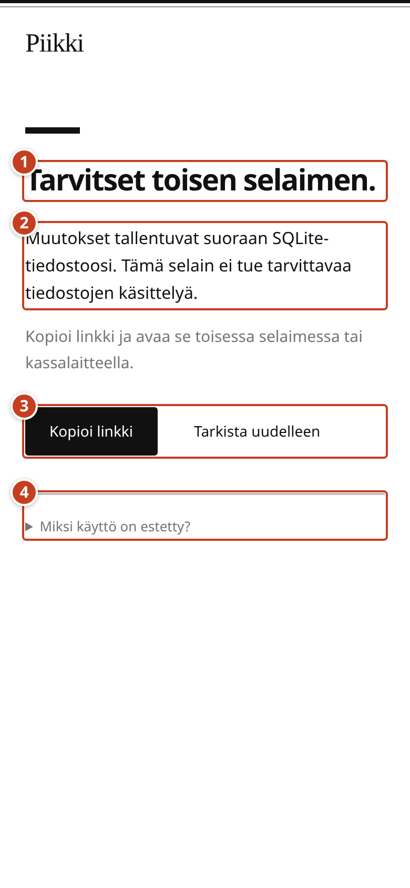

1. Read the blocked state at **1** and the file-access explanation at **2**. The workspace is unavailable when required capabilities are missing.
2. Select **Kopioi linkki** in area **3**, then open that link in another browser or on another device. The button changes to **Linkki kopioitu** after a successful copy. If copying is unavailable, a selectable link field appears.
3. Select **Tarkista uudelleen** at **3** to reload and repeat the capability check.
4. Expand **Miksi käyttö on estetty?** at **4** for the specific reason.

On an insecure connection, this screen instead offers **Avaa suojattu sivu**. Use HTTPS, or localhost for an app running on the same device.

The app checks actual browser APIs, not browser names. It also checks write permission and verifies an initial file write before opening an account session. There is no download-only mode for unsupported browsers.

## Screenshot capture notes

These are screenshots of the running app with numbered annotations added over its controls. Desktop screenshots use a 1280 by 900 viewport. The compatibility screenshot uses a 390 by 844 viewport.

For capture automation, a temporary browser-managed SQLite file supplied a real writable file handle in place of the native file picker. No production accounts were used. The app's writer saved each example transaction. Reopening the file confirmed Aino's final balance of `44.00`, the new person's `0.00` balance, the restored `4.25` shortcut, and the saved primary color. A backup download also completed. The temporary browser file was removed afterward.

The native external-file picker and permission dialogs are described in the guide but are not captured. The unsupported-browser screenshot renders the app’s compatibility component with the missing-file-API explanation. No app source changes or browser-storage fallback were added for this guide.

Capture helpers and annotation targets are in `docs/usage/capture-helpers.js`. Import them in a browser preview of the Vite development server, run the stages in order, and save a screenshot after each stage. The helpers wait for fonts and animations before positioning annotations. Run `python3 docs/usage/render_guide.py` after updating the PNG files to refresh the offline guide.
