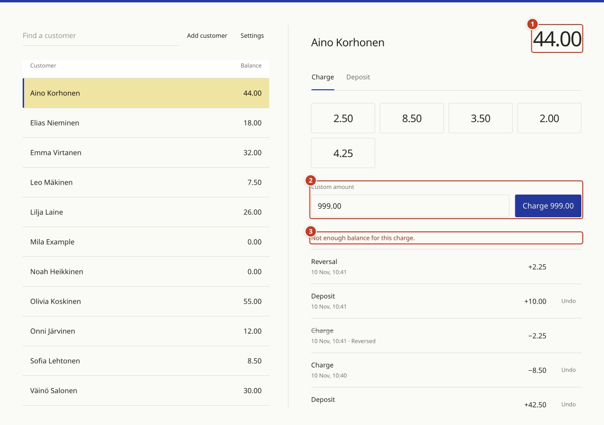

# Use the customer balance app

Open a database, select a customer, and charge or deposit an amount. Changes save to the SQLite file automatically. Use **Download backup** when you want a separate copy.

The numbered circles and outlines in each screenshot identify the controls described below. Screenshots use sample accounts. Amounts display two decimal places without currency symbols. Enter `8.50` to subtract 850 of the smallest credit units. You can also enter `8,50`.

## 1. Open or create a database

1. Select **Open database** at callout **1** and choose an existing compatible SQLite file. Allow read and write access when the browser asks.
2. To start with no customers, select **Create database** at **2** and choose a save location and filename.
3. To practice with sample accounts, select **Try example** at **3**. Choose a separate save location for the sample database.

The account workspace opens after the app checks the database and verifies file writing. The browser's file and permission dialogs are not pictured because they vary by device.

You can also drop a compatible SQLite file onto the page. The app then asks for a writable destination before opening the imported copy. Keep track of the destination you choose, since that is the file subsequent changes update. An unrelated SQLite file will not work just because its extension is `.sqlite` or `.db`.

## 2. Find your way around the workspace

1. Use the search field, **Add customer**, and **Settings** in area **1**.
2. Select a customer in the table at **2**. The highlighted row identifies the selected account.
3. Check the customer's name and current balance at **3** before entering a transaction.
4. Select an amount at **4** to charge it immediately.
5. Enter another amount at **5**, then select the labeled charge or deposit button.
6. Review transactions at **6**. Newest entries appear first, with an **Undo** button beside entries that can be reversed.

The table and account panel show the same saved balance. The app does not display customer IDs, product names, or the active filename. Select **Customer** or **Balance** in the table's column labels to change its sort order.

## 3. Search for and select a customer

1. Enter part of the customer's name in the search field at **1**.
2. Select the matching name at **2**.
3. Check the name and balance at **3**. In this example, Elias has `18.00`.

Typing in search filters the table. It does not select a different customer by itself. Clear the search field to show everyone again. If no names match, check the spelling or enter a shorter part of the name.

The remaining transaction examples use Aino, whose starting balance is `42.50`.

## 4. Add a customer

1. Select **Add customer** beside the search field.
2. Enter the customer's name at **1**. Use a name the cashier can distinguish from other accounts.
3. Select **Add customer** at **2** to save it. Select **Cancel** to leave without adding anyone.
4. Find and select the new customer in the table.

A new customer's balance starts at `0.00`. Use a deposit to add their initial credit. Adding a customer does not change the currently selected account. Customer names cannot currently be edited or removed through the UI.

## 5. Apply a quick charge

A quick-charge button subtracts its amount immediately. There is no charge confirmation dialog.

1. Select the customer and check their name.
2. In **Charge** mode, select the `8.50` quick-charge button at **1** once.
3. Check the updated balance at **2** and the new history entry at **3**.

In this example, `42.50` becomes `34.00`. The history records a charge of `−8.50`. Buttons are disabled while the change saves. A quick-charge button is also disabled if the customer cannot cover its amount.

If you select the wrong amount, use **Undo** on that transaction. See section 8.

## 6. Charge a custom amount

1. Select **Charge** mode.
2. Enter `2.25` in **Custom amount** at **1**.
3. Check the button text, then select **Charge 2.25** at **2**. Pressing Enter in the amount field also submits the charge.

The amount clears after the change saves. In this example, the balance changes from `34.00` to `31.75`, and a `−2.25` entry appears in the history.

Use a positive amount with no more than two decimal places. Zero, negative values, and values such as `2.255` are rejected.

## 7. Record a deposit

Record a deposit after receiving the customer's payment. The app records credit; it does not collect payment from a bank or card.

1. Check the customer's name and select **Deposit** at **1**.
2. Enter `10.00` in **Amount to deposit** at **2**.
3. Select **Deposit 10.00** at **3** once.

The change applies without another confirmation. In this example, `31.75` becomes `41.75`, and the history gains a `+10.00` deposit. Switch back to **Charge** when you want to subtract credit.

## 8. Undo a transaction

1. Find the transaction in the selected customer's history.
2. Select **Undo** beside that entry.
3. Check the customer and amount in area **1**. This example reverses the custom charge of `2.25`.
4. Select **Reverse transaction** at **2** to apply the reversal. Select **Cancel** to leave the transaction unchanged.

Undo has its own confirmation because it changes an existing transaction. Reversing a charge adds the amount back. Reversing a deposit subtracts it. A deposit can be reversed only when the current balance covers the full amount being removed.

## 9. Check a reversal in the history

1. Check the new balance at **1**. Reversing the `2.25` charge changes `41.75` to `44.00`.
2. Find the new **Reversal** entry at **2**, showing `+2.25`.
3. Find the original charge at **3**. It remains visible and is marked **Reversed**.

A transaction can be reversed once. The reversal itself has no **Undo** button. History is preserved rather than deleted.

## 10. Change the two colors

1. Select **Settings** beside the search field.
2. Open **Branding**.
3. Choose the **Primary color** at **1** for action buttons and interface accents.
4. Choose the **Secondary color** at **2** for the selected customer row.
5. Select **Save colors** at **3** to apply and save the changes.

The button is disabled until a color changes. This screenshot shows a new primary value of `#263AA5` before it is saved. Colors are stored in the SQLite database and return when that file is reopened. Button and selection text colors adjust for contrast.

Select **Done** to close Settings. The browser compatibility screen does not display a logo or app wordmark.

## 11. Add or edit quick-charge amounts

1. Open **Settings**, then select **Quick charges**.
2. Review the saved amounts in the list at **1**.
3. Enter `4.25` in **New amount** at **2**.
4. Select **Add amount** at **3**.

To change an existing amount, select **Edit** beside it. Enter the replacement amount and select **Save amount**. Select **Cancel edit** to leave it unchanged.

Select **Done** and return to **Charge** mode to use the saved shortcuts. Quick-charge settings change future buttons only. They do not alter past transactions or customer balances.

## 12. Remove and restore a quick-charge amount

1. Use **Edit** at **1** to change an amount rather than remove it.
2. Select **Remove** at **2** to delete a shortcut from the list.
3. If you removed it by mistake, select **Restore 4.25** at **3** before closing Settings.

The restore button holds only the most recently removed amount during that Settings session. Removing another amount replaces it. Closing Settings clears that restore option; you can still add the amount again later.

## 13. Save, back up, and reopen your work

1. Open **Settings**, then select **Database**.
2. Read the save behavior at **1**. Charges, deposits, reversals, settings, and new customers save to the opened file automatically.
3. Select **Download backup** at **3** when you want an additional SQLite copy. Wait for the browser to finish the download.
4. To switch files, select **Open database** at **2**, choose the file, and grant write access.

You do not need a download after each change. A downloaded backup is a separate snapshot and does not become the active file.

When you return to the app after closing or reloading it, open your working SQLite file again. The app does not remember writable file handles between visits. Keep one app instance editing a file at a time. Copies edited separately do not merge.

If **Restore local copy** appears on the start screen, it refers to an older browser recovery copy. Restoring it asks for a writable destination. Prefer your working SQLite file when it is available.

## 14. Handle a rejected charge or failed save

1. Check the unchanged balance at **1**.
2. Check the entered amount at **2**. Here, a charge of `999.00` exceeds the `44.00` balance.
3. Read the error at **3**, then correct the amount or record a deposit after receiving payment.

A rejected charge does not change the balance or add a transaction.

If a file write fails, the app restores the previous balance and shows an error. Restore write access or file availability before retrying. If the file changed outside the app, reopen the latest file rather than overwriting it. If a file cannot open, check that it is a compatible database and that you granted write access.

## 15. Handle an unsupported browser

1. Read the blocked state at **1** and the file-access explanation at **2**. The cashier workspace is unavailable when required capabilities are missing.
2. Select **Copy link** in area **3**, then open that link in another browser or on the cashier device. The button changes to **Link copied** after a successful copy. If copying is unavailable, a selectable link field appears.
3. Select **Check again** at **3** to reload and repeat the capability check.
4. Expand **Why is access blocked?** at **4** for the specific reason.

On an insecure connection, this screen instead offers **Open secure page**. Use HTTPS, or localhost for an app running on the same device.

The app checks actual browser APIs, not browser names. It also checks write permission and verifies an initial file write before opening an account session. There is no download-only mode for unsupported browsers.

## Screenshot capture notes

These are screenshots of the running app with numbered annotations added over its controls. Desktop screenshots use a 1280 by 900 viewport. The compatibility screenshot uses a 390 by 844 viewport.

For capture automation, a temporary browser-managed SQLite file supplied a real writable file handle in place of the native file picker. No production accounts were used. The app's writer saved each example transaction. Reopening the file confirmed Aino's final balance of `44.00`, the new customer's `0.00` balance, the restored `4.25` shortcut, and the saved primary color. A backup download also completed. The temporary browser file was removed afterward.

The native external-file picker and permission dialogs are described in the guide but are not captured. The unsupported-browser screenshot was captured after removing a required picker API in the test page. No app source changes or browser-storage fallback were added for this guide.
